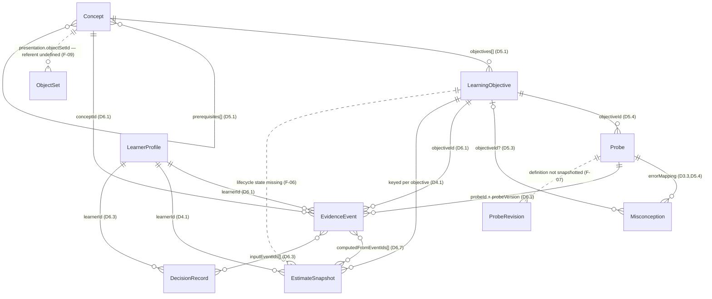

# I13 — ENTITY-RELATIONSHIP VALIDATION

**Status:** investigation complete. **Verdict: FAIL as specified.**
**Date:** 2026-11-10
**Timebox:** 1 day (used: 1 day)
**Authorisation:** owner-approved investigation, 2026-11-10. Investigation and documentation only — no application code, no migrations, no dependencies, no D5.2 implementation.
**Governing documents:** `DECISION-REGISTER.md` v0.3 (`§4` D4, `§5` D5, `§6` D6, `§2` D2), `D10.3` measurement horizons.
**Closure status:** I13 is **not** closed. D5.2 implementation remains gated. This report records what breaks and what must be decided; it decides nothing.

---

## 1. What was validated, and to what standard

The chain under test:

`Concept → LearningObjective → Probe → EvidenceEvent → EstimateSnapshot`

Five checks were run, per the owner's safeguards: cardinality, ownership, optionality, lifecycle, and referential integrity; real evidence flows rather than representability; a conflicting-evidence scenario; historical integrity across three kinds of version change; and an explicit refusal to resolve any gap by inventing a decision.

**The standard used matters, so it is stated first.** `D3.2` deliberately delegates concrete schemas to code (`content/`, `lib/`) and keeps prose out of it. Therefore **"a field is absent from the register" is not, by itself, a defect.** The test applied here is stricter and narrower:

> A structural break exists when two register statements cannot both hold, or when a DECIDED statement cannot be made operational without a further decision that the register does not contain.

Findings of the second kind are gaps, not contradictions, and they are labelled as such. This distinction is the reason the verdict is FAIL rather than BLOCKED: nothing external is missing — every break is inside the model's own definitions.

**Limits of this validation.** It was performed against the register text. There is no code, no schema, no migration and no running system to test, so nothing here confirms that an implementation behaves as described; it confirms only that the specification is either internally consistent or not. Section 12 lists what remains unvalidated by construction.

---

## 2. Verdict

**FAIL** — 5 blocking findings, 3 major, 3 moderate.

| ID | Finding | Class | Severity |
|---|---|---|---|
| F-01 | Static `contextNovelty` on the probe cannot express learner-relative novelty, so `robust` is reachable by repetition alone | Contradiction (D2.5 Tier 2, D4.7 vs D5.4) | **Blocking** |
| F-02 | Threshold authority is split across three owners with three versioning regimes; a content edit changes interpretation without bumping `estimatorVersion` | Contradiction (D5.2, D4.7, D10.3 vs D6.7) | **Blocking** |
| F-03 | `confidence` is mandatory on every decision record (D6.3) while uncertainty semantics are undefined and percentages prohibited until I8 (D4.7b) | Contradiction (D6.3 vs D4.7b) | **Blocking** |
| F-04 | The path from an observed signature to an estimate is undefined: `errorMapping` targets misconceptions, and `Misconception.objectiveId` is optional | Gap (D5.3, D5.4, D4.4 → D4.1) | **Blocking** |
| F-05 | C4's own measurement definition (brief exposure, no opportunity to count) is not expressible in the probe schema, so a C4 claim cannot be falsified | Contradiction (D2.2 C4 vs D5.4) | **Blocking for C4** |
| F-06 | `LearningObjective` has no lifecycle state, so after an I9 split, historical snapshots reference objectives that no longer exist in content | Gap (D5.2, D6.7) | Major |
| F-07 | `probeVersion` identifies a number, not a definition; the probe as presented is not recoverable from the model | Gap (D5.8, D6.7) | Major |
| F-08 | One event carries exactly one `objectiveId`, so a response bearing on two objectives must be duplicated — and duplication satisfies D2.5's "two presentations" | Gap (D5.2 vs D2.5) | Major |
| F-09 | Object-set identity is required by a DECIDED rule (D2.5) but never defined as an entity, so Tier 2 is not machine-checkable | Gap (D2.5 vs D5.4) | Moderate |
| F-10 | Append-only immutable evidence (D6.1) is unreconciled with child deletion rights (D7.2/I10); evidence carries no consent-version reference | Contradiction, deferred to I10 | Moderate |
| F-11 | No canonical belief state: hypothesis distributions exist only inside point-in-time decision records, with no rule for which governs "now" | Gap (D4.4, D4.4a vs D6.3) | Moderate |

**What this means practically:** D5.2 can be written as a type today, and the first three worked examples mostly flow. But at least three DECIDED rules would be silently violated the moment the system accumulated real evidence — F-01 lets a child reach `robust` by repetition, F-02 destroys the audit trail D6.7 exists to provide, and F-04 breaks the evidence→estimate link at the exact point where suspicion about the child's answer is converted into an update. **None of these is a schema inconvenience; each is a failure of the register's own integrity guarantees.**

---

## 3. Entity relationship diagram, as specified

Relationships drawn only where the register states or unambiguously implies them. Dashed = required by a DECIDED rule but not modelled.



### 3.1 The chain, read as data

| Hop | Owner | Cardinality | Who may write | Lifecycle |
|---|---|---|---|---|
| `Concept → LearningObjective` | content | 1 → 0..n | authoring only | content revisions; objective IDs stable, never reused (D5.2) |
| `LearningObjective → Probe` | content | 1 → 0..n | authoring only | `probeVersion` bumps on behaviour change (D5.8) |
| `Probe → EvidenceEvent` | runtime | 1 → 0..n | append-only | immutable (D6.1) |
| `LearnerProfile → EvidenceEvent` | learner | 1 → 0..n | append-only | immutable; no deletion path (F-10) |
| `EvidenceEvent → EstimateSnapshot` | estimator | n ↔ n | append-only | snapshots superseded, never overwritten (D6.7) |
| `LearningObjective → EstimateSnapshot` | estimator | 1 → 4 × 0..n | append-only | four estimates per objective (D4.1) |

The **ownership boundary is clean** on the one axis that matters most: content is authored and static; evidence is appended and never edited; snapshots and decisions are derived and append-only. No entity is writable by the surface that reads it. That part of the chain holds, and it should be recorded as holding, because it is the property the whole audit trail depends on.

---

## 4. Cardinality and ownership validation

Twelve checks. Each is PASS, FAIL, or FAIL-BY-GAP with the finding reference.

| # | Check | Result |
|---|---|---|
| C-01 | Every objective belongs to exactly one concept; a concept owns many objectives | **PASS** — `Concept.objectives[]` + `LearningObjective.conceptId` is consistent in both directions |
| C-02 | Every probe targets exactly one objective | **PASS as modelled**, but see C-08: the restriction is real and load-bearing |
| C-03 | Every evidence event names one probe, one probe version, one objective, one concept | **PASS** — D6.1 |
| C-04 | Concept/objective/probe identity copied onto the event is denormalised and can drift from content | **RISK, not a break** — drift is prevented only if `probeVersion` pins a definition; that is F-07 |
| C-05 | Four estimates per (learner, objective), with expression further keyed by channel | **PASS in principle, gap in identity** — no stated discriminator distinguishes the four rows, and `expression[o][channel]` needs a channel that is null for the other three. Needed for a uniqueness constraint; F-02's family |
| C-06 | An event may contribute to many snapshots (reprocessing) | **PASS** — `computedFromEventIds[]`; note it is an in-record array, so referential integrity is application-enforced, not FK-enforced |
| C-07 | Snapshot → "current" is unique per (learner, objective, estimate kind, channel) | **FAIL BY GAP** — no current-selection rule; D6.7 requires retaining history but does not say which snapshot a guardian view reads |
| C-08 | One response maps to one objective | **FAIL** — F-08 |
| C-09 | Every signature maps to an estimable target | **FAIL** — F-04 |
| C-10 | A misconception always implies an objective | **FAIL** — `objectiveId?` is optional by design (D5.3), yet D4.4 hypotheses are objective-level beliefs |
| C-11 | Prerequisites relate the unit that is estimated | **FAIL BY GAP** — `Concept.prerequisites[]` is concept-level; estimation is objective-level (D4.1). Objective-level gating is not expressible, and nothing forbids prerequisite cycles |
| C-12 | Content identity survives content revision | **FAIL** — F-06 (objectives) and F-07 (probes) |

**Ownership:** every learner-owned entity traces to `learnerId`; D7.5 scopes queries server-side. Content entities have no owner and must not: correct. `sessionId` on the event has **no owning entity defined anywhere in the register** — a minor referential gap, recorded under F-09's family.

---

## 5. Worked example 1 — C3, and the point where `robust` becomes reachable by repetition

Content below is **illustrative only** and decides nothing; I9 has not fixed the C3 decomposition.

- `O-C3-01`: answers "how many?" for 4–10 objects after counting them, independently.
- Probes: `P-C3-04` (6 objects, linear, tap_select, `contextNovelty` 0), `P-C3-07` (8 objects, scattered, point_at_screen, 0), `P-C3-09` (9 objects, scattered, distractors, tap_select, 2).

### 5.1 The flow that works

| Event | Probe | Support | Outcome | Novelty | Contributes to |
|---|---|---|---|---|---|
| E1 | P-C3-04 | independent | correct | 0 | knowledge, expression[tap_select] |
| E2 | P-C3-07 | independent | correct | 0 | knowledge, expression[point_at_screen] |
| E3 | P-C3-09 | independent | correct | 2 | knowledge, transfer, expression[tap_select] |
| E4 (+7 days) | P-C3-09 | independent | correct | 2 | retention, transfer |

Derivation as the register requires it:

- `knowledge`: three independent successes, two channels, two object sets → `consistent`. Not `robust`, because D4.7 requires a delayed agreement, which does not exist until E4.
- `expression[tap_select]`: two independent successes → `consistent`. `expression[point_at_screen]`: one → `emerging`. The channels stay separate, as D4.10 requires.
- `transfer`: one success at novelty 2 → `emerging`. D2.5 Tier 2 requires two distinct object sets *and* two distinct arrangements; only `P-C3-09` exists at novelty 2, so by the register's own rule the claim is not yet available. **The engine correctly refuses mastery here.** This is the chain working.
- `retention`: after E4, a delayed probe agrees → `consistent`, and only now may `knowledge` be promoted to `robust`.

### 5.2 The same flow, corrupted — F-01

Now replay E3 at novelty 2 three more times on four separate days, with no new probe:

| Event | Probe | Novelty recorded | Actual familiarity |
|---|---|---|---|
| E3 | P-C3-09 | 2 | first exposure |
| E5 | P-C3-09 | 2 | second |
| E6 | P-C3-09 | 2 | third |
| E7 | P-C3-09 | 2 | fourth |

`contextNovelty` is a **static field on the probe** (D5.4), copied verbatim onto every event (D6.1). So four repetitions of one activity are all recorded as four independent observations in an unfamiliar context. That satisfies "survives an unfamiliar context" and "agrees with a delayed probe", and `knowledge` reaches `robust` — with the child having done exactly one thing, four times, and never having been tested for transfer at all.

This is not a niche edge case. Exploring the same activity repeatedly is the **normal** behaviour of a young child (D2.5 Tier 1 explicitly invites it), and D2.5's entire anti-memorisation purpose is to prevent a claim from resting on repetition of a familiar layout. The register states the requirement in learner-relative terms — *unfamiliar to this child* — and then models it as a property of the artefact. **Those two things cannot both be true.** Either novelty is computed per learner from prior exposure (and therefore is not a probe field), or D2.5's Tier 2 condition must be rewritten in terms of distinct probe families. That choice is a decision, not a schema detail: it changes what counts as evidence. Recorded as **I13-a**.

---

## 6. Worked example 2 — C6, and whether the three abilities can stay separate

The owner's specific requirement: comparison, ordering and conservation must remain independently represented without collapsing into one estimate.

- `O-C6-CMP`: identifies more/fewer/same between two sets.
- `O-C6-ORD`: orders three sets of 1–10 by size.
- `O-C6-CONS`: judges that quantity is unchanged after rearrangement.

### 6.1 Non-collapse holds, and the reason is structural

Because **`EstimateSnapshot` is keyed to `objectiveId`** (D4.1) and **`EvidenceEvent` carries `objectiveId`** (D6.1), a conservation event is physically incapable of writing a comparison estimate. There is no C6-level row for anything to collapse into, and D4.1 forbids a scalar. Independence is therefore not a convention that can be accidentally broken by an implementer — it is enforced by the key. **PASS.**

Worked trace: `P-C6-ORD-02` (arrange_sequence, 3 sets) fails with signature `order_by_height_not_quantity` → event E8, `objectiveId: O-C6-ORD` → snapshot for `O-C6-ORD` only. `O-C6-CMP` and `O-C6-CONS` snapshots for that learner are untouched and continue to read whatever their own events support. A guardian view saying "has not yet shown ordering" while saying "consistently compares" is directly supported by the data, which is what P1.5 and D4.10 demand. This finding should be recorded positively: the decomposition requirement is met at the model level.

### 6.2 Break one — an inference with no estimable target (F-04)

`P-C6-CONS-01` (conservation) yields signature `believes_rearrangement_changes_quantity`. `errorMapping` maps it to `M-CONS-01`. Now look at the target:

```
Misconception { id: "M-CONS-01", conceptId: "C6", objectiveId?: undefined, ... }
```

`objectiveId` is optional (D5.3). With it absent, the signature is recorded, the misconception is identified, the decision record can name it — and **no estimate updates.** The register never says what should happen instead. Three behaviours are currently admissible and all three are wrong in different ways: silently update nothing (evidence collected and discarded); fall back to the event's `objectiveId` (which conflates *the probe's target* with *the inference's target*, and is exactly how a conservation failure becomes a counting failure); or raise an error (the system cannot record a legitimate observation).

Note the deeper problem: `errorMapping` maps **signature → misconception**, and misconceptions are not estimates. The chain `observation → signature → hypothesis → estimate update` is therefore broken at its last hop. D4.4's nine explanations are also not objectives — `not_understood` is a belief about *an objective*, but nothing in the model binds a hypothesis to one. Recorded as **I13-d**.

### 6.3 Break two — conservation pulled into C3 (F-08, and the I9 question)

I9 leaves open whether conservation belongs under C3 or C6 (D5.2). If it is placed under C3, then `M-CONS-01` carries `conceptId: C3`, and a child who counts perfectly but expects a spread-out row to contain more objects produces an event whose natural attribution is `O-C3-01`. The estimator then has a signature suggesting a counting deficit, attached to the counting objective.

That is a violation of D4.7's explicit prohibition: `none_observed`/`emerging` must not mean "cannot perform". A conservation failure would depress a counting estimate on evidence that says nothing about counting. **The register does not forbid this**, because it does not require a misconception's estimate target to be stated explicitly and independently of the probe that surfaced it.

Similarly, the reverse: conservation is a *reasoning* ability about invariance, and if it lives under C3 then C3's knowledge estimate silently mixes "can count and report" with "believes quantity is conserved". Two abilities in one estimate is precisely what D4.1 exists to prevent — one level below the concept. Recorded as part of **I13-d**, with the placement question itself returning to **I9**.

---

## 7. Worked example 3 — C4, where the measurement definition cannot be expressed

`D2.2` C4 requires: *"accuracy, consistency across presentations, controlled presentation conditions (brief exposure, no opportunity to count), and the chance to show the behaviour again. Latency is supporting evidence only (D4.8)."*

`D5.4` gives `presentation: { objectSetId, quantity, arrangement, distractorCount, responseLayout }`. There is **no exposure duration and no response window.** `D6.1` adds `latencyMs` and nothing else temporal beyond `startedAt`.

Consequence, stated plainly: a subitizing result cannot be distinguished from a counted result. The only property that makes C4 falsifiable — that the child had no time to count — is not recorded anywhere. And because D4.8 forbids latency from independently establishing anything, there is no substitute discriminator available either. So:

- A `correct` outcome on `P-C4-11` is admissible whether the child recognised three dots instantly or counted them over four seconds.
- The estimate `knowledge[O-C4-01]` therefore records *"answered correctly"*, which is a C3-shaped claim, not a C4 one.
- D2.5 Tier 2's requirement that "at least one condition makes counting impractical" **can be satisfied in intent and never in record.**

**This is the clearest break in the chain, because it is not an ambiguity: the concept's own definition cannot be represented by the schema that must evidence it.** A C4 mastery claim produced from this model would be unfalsifiable, and unfalsifiable evidence is a direct violation of P1.7 — it would manufacture a successful-looking outcome from an artefact of the schema. Recorded as **I13-b**.

Same family, smaller: `outcome: correct | partial | no_response` (D6.1) — **`partial` is never defined**, yet a failed or partial probe is what triggers the hypothesis distribution (D4.4), so the enum that gates the whole inference path has an undefined member.

---

## 8. Conflicting evidence — does the model preserve disagreement?

Scenario, three sessions, one objective `O-C3-01`:

| Session | Event | Channel | Outcome | Decision |
|---|---|---|---|---|
| A | E10 | tap_select | `no_response` | D-1: {`understood_but_unexpressed` .50, `accessibility_or_channel_limit` .30, `not_understood` .20} (D4.9 prior) |
| B | E11 | point_at_screen | correct, independent | D-2: {`K1_confirmed_across_channels`}, reason code `K1` |
| C | E12 | tap_select | `no_response`, `endedReason: child_abandoned` | D-3: {`attention_or_state` .55, `understood_but_unexpressed` .30, `not_understood` .15} |

What survives: **every** distribution, verbatim, inside its own decision record. Nothing is overwritten, D4.4's "retain two or more competing explanations" is satisfied at the *record* level, and D6.7's "what did we believe then" is answerable for any past instant.

What does not survive: **any single answer to "what does Lumi believe now"**. The three decisions are mutually inconsistent by design — D-2 says the concept is confirmed, D-3 says attention is the likeliest explanation — and the register contains no rule for reconciling, superseding or ranking them, because there is no belief entity for them to write into. `EstimateSnapshot` cannot hold a hypothesis distribution: it is keyed four ways for four estimates and carries no `hypothesisSet`. So "the model preserves disagreement" is true only in the archaeological sense. A guardian view, an adaptive pathway and a next-probe chooser all need the current distribution, and all three would have to invent their own reconciliation.

This also collides with F-03 directly: D6.3 requires `confidence` on each decision record, while D4.7b prohibits percentages until I8 defines the quantity and warns against numbers that "look scientific and are not." A required numeric field with prohibited semantics is a contradiction, and it is sitting inside the append-only record that P1.7's whole audit claim rests on. Recorded as **I13-c** (belief state and the `confidence` field together — they cannot be decided separately).

---

## 9. Versioning and historical integrity

Three change scenarios, each tested against D6.7's requirement: *"what did we believe then, on what grounds, under which version, and what do we believe now."*

### 9.1 `estimatorVersion` 1 → 2 (replay)

Events E1–E7 unchanged. Version 2 emits new snapshots with `computedFromEventIds` and `estimatorVersion: 2`; version 1 snapshots are retained. **PASS.** Both beliefs are present, both are reproducible from events, and the grounds are the event IDs. This is the case D6.7 was designed for and it works.

One gap remains (C-07): with two snapshot generations present, nothing states which one a surface reads. Cheap to fix, must not be left to each consumer.

### 9.2 `probeVersion` bump on `P-C3-09`

`P-C3-09` v1: 9 objects, scattered, 3 distractors. v2: 9 objects, grid, 1 distractor. D5.8 says evidence from v1 "remains valid but is tagged."

Tagged with a number. **What v1 actually asked is not recoverable from the model**, because the probe definition is mutable content and only its version integer is copied onto the event. So the record shows "correct, P-C3-09 v1" and cannot show whether v1 was the harder layout. Two consequences: the tagged evidence cannot be re-judged under a new probe interpretation (which is the *point* of tagging), and D2.5's "two distinct arrangements" cannot be verified retrospectively from evidence alone. **FAIL BY GAP — F-07.** Requires either an immutability rule for probe definitions or a `ProbeRevision` snapshot entity.

### 9.3 An objective is split after I9

Suppose `O-C6` is split into `O-C6-CMP`, `O-C6-ORD`, `O-C6-CONS` (as example 2 already assumes). Pre-split events carry `objectiveId: O-C6`. `O-C6` now exists in no content file.

`LearningObjective` has no `retiredAt`, no `splitInto[]`, no `supersededBy`. So the historical snapshot references an objective that content cannot resolve: its statement, its observable behaviour and its `evidenceThreshold` are gone, and the register's own stability rule ("IDs are stable and never reused; renaming keeps the ID") **does not cover splitting at all**. D6.7's "on what grounds" fails here, not because evidence was lost but because its meaning was. **FAIL BY GAP — F-06**, and note that this is not hypothetical: I9's resolution will perform exactly this operation on C6, and possibly C1/C4.

Also uncovered by D6.7: `evidenceThreshold` (D5.2) and the band rules (D4.7) are two different statements of the same thing in two different owners, and `~7 days` (D10.3) is a third. A content edit to `evidenceThreshold` changes what a band means without bumping `estimatorVersion`, so two snapshots labelled v2 can be computed under different mastery rules and be indistinguishable in the record. **F-02**, blocking, because it defeats the audit trail by leaving it intact and wrong.

---

## 10. Structural contradictions

| ID | Two statements that cannot both hold | Owner of the conflict |
|---|---|---|
| F-01 | D2.5/D4.7 require *learner-unfamiliar* context; D5.4/D6.1 record a *static* `contextNovelty` copied from the probe | D2.5 Tier 2, D5.4 |
| F-02 | D6.7 gives `estimatorVersion` sole ownership of interpretation; D5.2 puts `evidenceThreshold` in content, D10.3 puts the retention window in prose | D5.2, D4.7, D6.7 |
| F-03 | D6.3 mandates a `confidence` value on every decision; D4.7b forbids expressing uncertainty numerically before I8 | D6.3, D4.7b |
| F-04 | D4.4 requires objective-level competing hypotheses; D5.3 makes a misconception's `objectiveId` optional and D5.4 targets misconceptions from signatures | D5.3, D5.4, D4.4 |
| F-05 | D2.2 C4 requires controlled brief exposure; D5.4 has no exposure or response-window field | D2.2, D5.4 |
| F-10 | D6.1 makes evidence immutable and append-only; D7.2/I10 require a child's data to be deletable | D6.1, D7.2, I10 |

---

## 11. Missing relationships and attributes

Required by a DECIDED statement, absent from the model, and not resolvable by a schema author alone:

| Missing | Required by | Consequence if left |
|---|---|---|
| `ObjectSet` entity (identity exists only as an opaque `objectSetId`) | D2.5 "two distinct object sets" | Tier 2 compliance cannot be checked, by machine or reviewer |
| Per-learner exposure history to a probe or presentation (or an accepted alternative) | D2.5, F-01 | `robust` reachable by repetition |
| `exposureMs` / `responseWindowMs` on `presentation` | D2.2 C4, D2.5 | C4 unfalsifiable |
| Definition of `outcome: partial` | D6.1, D4.4 | Undefined member gates the hypothesis path |
| Estimate discriminator (`estimateKind` + `channel`, nullable) | D4.1 | No uniqueness constraint on the four estimates (C-05) |
| Current-snapshot selection rule | D6.7 | Consumers each invent one (C-07) |
| `LearningObjective` lifecycle (`retiredAt`, `splitInto[]`, `supersededBy`) | D5.2, D6.7 | Historical snapshots uninterpretable after I9 (F-06) |
| Probe definition snapshot or immutability rule | D5.8, D6.7 | "Which version" answerable, "what was asked" not (F-07) |
| Estimate target for a hypothesis / error mapping | D4.4, D5.3 | Evidence→estimate link broken (F-04) |
| Belief-state rule (recompute-on-read vs stored) | D4.4, D4.4a | Current belief undefined across conflicting decisions (F-11) |
| `Session` entity (or an explicit statement that `sessionId` is opaque) | D6.1 | Dangling reference (minor) |
| Consent-version reference on evidence or session | D7.8, D8.0 | "Collected under which consent" unanswerable (F-10) |

**Not defects, worth saying:** probes carry no ownership, learners carry no content reference, and snapshots carry no content version. Each of those is correct, because content is authored and learner data is derived. The boundary between authored and observed data is drawn properly; the breaks are all inside the observed side.

---

## 12. What could not be validated

Recorded so the verdict is not read as broader than it is.

1. **Constraint-level correctness** (FKs, unique indexes, cascade behaviour, RLS) — belongs to I2, after the schema freezes. Nothing here was tested against a database.
2. **Uncertainty mathematics** — I8. F-03 was found without needing I8: the contradiction is that a field is mandated while its semantics are prohibited, not what the number should be.
3. **The I9 decomposition itself** — the C3/C6 objective trees in examples 1 and 2 are illustrative. If I9 places conservation under C3, F-04 and F-08 get worse, which is the reason §6.3 is written as a finding rather than a preference.
4. **Probe design and leakage** — D5.8's authoring gate is out of scope. This report says nothing about whether any specific probe is anti-memorisation proof; only that the model cannot record the properties the gate requires.
5. **Consent law and deletion** — I10. F-10 is stated as a modelling tension, not a legal opinion; no compliance claim is made (D8.0).
6. **Performance and cost** — not assessed; no implementation exists.

---

## 13. Recommended amendments to the register

**Nothing below has been applied as a decision.** Each is a proposal with its cost. Two classes: those that are decisions (they change what counts as evidence or what may be claimed), and those that are attribute additions that still need the owner's approval because `D3.2` keeps schemas in code.

### Class A — require a decision (raised as investigations)

| Ref | Proposal | Blocks |
|---|---|---|
| **I13-a** | Fix novelty in learner-relative terms: either novelty is computed per learner from exposure history (probeless), or Tier 2's transfer condition is rewritten over distinct probe families. Cannot be both. | Any `transfer` or `robust` claim; D5.8 authoring; D5.2 |
| **I13-b** | Restore expressibility of C4: add exposure/response-window to the probe and evidence model, or redefine C4's observable behaviour so it does not depend on time pressure. | C4 authoring and any C4 claim |
| **I13-c** | Define the belief state and the status of `confidence`: recompute-on-read from events (and what determinism that requires), or a stored `HypothesisState`; and either define `confidence` or remove it until I8. | D6.3 record shape; guardian view; next-probe chooser |
| **I13-d** | Bind every signature and hypothesis to an explicit estimate target, and decide conservation's home (C3 vs C6) as part of I9. Also define `partial`. | Evidence→estimate link; I9; C6/C3 independence |
| **I13-e** | Give objectives and probe definitions a lifecycle: retired/split states, split lineage, and either snapshot or immutability for probe definitions. | Historical integrity after I9; D5.8 tagging |

### Class B — attribute additions (no decision changes, owner approval still required)

1. `estimateKind` + nullable `channel` on the snapshot, with a uniqueness constraint (C-05).
2. A current-snapshot selection rule (C-07).
3. `ObjectSet` as a content entity with stable IDs (F-09).
4. A `Session` entity, or an explicit note that `sessionId` is opaque (minor).
5. Register-level statement of where thresholds live, once I13-b/I13-e settle it (F-02).

### Register edits this report does NOT propose

No change to D4.7's band table, D2.5's tiers, or D4.4a's abstention, all of which survived validation intact and are load-bearing for the findings above. No change to I8, I9 or I10, which remain open and now have sharper questions attached.

---

## 14. Verdict and closure condition

**I13: FAIL.** The chain `Concept → LearningObjective → Probe → EvidenceEvent → EstimateSnapshot` does not survive validation as specified. Independence of the four estimates (D4.1) and of C6's three abilities **does** hold and is enforced by keys, not convention — that half of the requirement is met. The evidence-to-estimate links that make those estimates honest do not hold.

**I13 is not closed, and D5.2 implementation stays gated.**

To re-open for validation, the register needs I13-a through I13-e decided (or explicitly deferred with their consequences accepted) and the Class B additions approved. A second pass is then cheap — one day — because the diagram and the twelve cardinality checks are already written and only the affected hops change.

**One observation for the record.** Five of the eleven findings are the same shape: a rule stated in learner-relative, meaning-dependent terms (unfamiliar *to this child*, brief exposure, competing explanations, a version's grounds) that was modelled as a static property of an artefact. That is a recurring failure mode, not five unrelated bugs, and it is worth naming in the register: **any rule about what a learner has experienced cannot be satisfied by a field on the content that was shown.** It is a direct corollary of P1.6 — the observation belongs to the learner, not to the material — and it would have caught F-01, F-05, F-07 and both halves of F-04 before authoring began.
